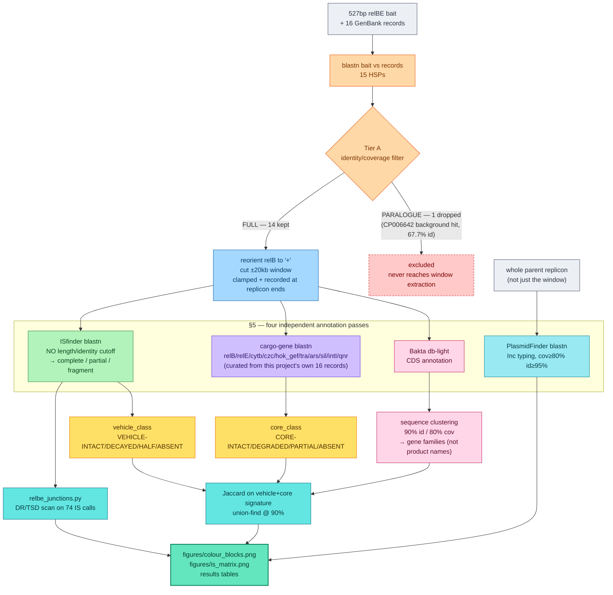
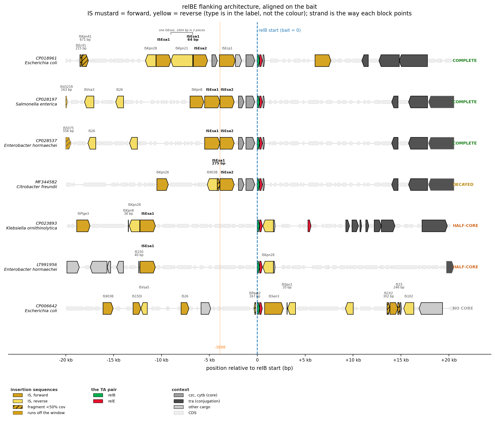

# relBE and its mobile genetic element context — pilot report

**Project:** TAflank · **Owner:** Pooja Sethiya · **Pilot date:** 2026-10-26 to 2026-11-03
**Source deck:** `relBE_schematic.pptx` (19 slides, 19 Aug 2026); hand-drawn predecessor:
`RelBE_from_Sept2018_lab_meeting.pptx`

---

## 1. What is relBE

`relBE` is a type II **toxin–antitoxin (TA) system** — a pair of adjacent, co-transcribed
genes:

- **relB** — the antitoxin. A small (79 aa) ribbon-helix-helix (RHH) DNA/protein-binding
  protein. On its own it is unstable and degrades quickly inside the cell.
- **relE** — the toxin. A slightly larger (95 aa) ribosome-dependent endoribonuclease.
  Left unchecked, it cleaves mRNA positioned in the ribosomal A site and halts
  translation.

The two genes overlap by one base pair and are transcribed as a single operon — the
classic co-transcribed TA arrangement. Under normal growth, RelB binds and neutralises
RelE. If the cell loses the DNA element carrying `relBE` (a plasmid cured, a chromosomal
region deleted), the short-lived RelB decays faster than the stable RelE, RelE is
released, and the cell's own translation machinery is shut down. This is a **post-
segregational killing / addiction module**: the TA pair does not do anything useful on
its own, but it makes whatever DNA molecule carries it much harder to lose, because
losing it is lethal.

That addictive property is the reason this project cares about `relBE` at all. It is
**not itself a mobile genetic element** — it has no transposase, no recombinase, nothing
that moves DNA. It is *cargo*: a hitchhiker that rides on mobile elements because those
elements benefit from being harder to lose. The question this pilot asks is what it
rides on, and whether the same vehicle carried it into every locus where it now sits, or
whether it got picked up independently, more than once.

## 2. The pipeline (TAflank)

TAflank is a bait-anchored discovery pipeline, built around a single idea: **anchor
every comparison on a gene of known identity, not on an assembly's own annotation**.
Point it at a bait sequence and a set of genomes, and it:

1. finds every high-confidence copy of the bait by BLAST, discarding sequence-divergent
   paralogues before they can contaminate anything downstream;
2. works out whether each copy sits on a plasmid or a chromosome;
3. cuts out a defined window of flanking sequence around each copy, reorienting every
   window the same way so positions are comparable across loci;
4. characterises the mobile genetic elements and the other genes (cargo) found in that
   window, using several independent tools and filters, none of which discard evidence
   silently.

The method follows Acman *et al.* 2022 (*Nat Commun* **13**:1131), who used exactly this
anchored, alignment-based approach to show that the carbapenem resistance gene *blaNDM*
spread on one ancestral vehicle. This pilot repeats that logic for `relBE`.

### Pipeline flow

Colour marks the role each stage plays: grey = input, orange = the Tier A/B/C filter
(§3), blue = window extraction (§4), the four annotation passes of §5 each get their
own colour, gold = the two classification axes (§5), teal = the TSD/Jaccard history
tests (§6–7), dark green = the deliverables (§8). GitHub/VS Code render this statically
— no click-through — but still support pan/zoom and the colour coding below.



## 3. The pilot test: 16 input records

The pilot used **16 closed GenBank records** as the search database — nine loci and two
negative controls hand-picked from a September 2018 lab-meeting survey, plus five
"extra" records that turned up free alongside them. Every record is annotated below with
how it was actually used, not just what it was labelled.

| accession | organism | set | replicon | relBE bait hit? |
|---|---|---|---|---|
| CP028197.1 | *Salmonella enterica* Concord | nine | plasmid pGMI14 (IncFIB) | yes, 100.0% id |
| CP028537.1 | *Enterobacter hormaechei* | nine | plasmid pQnrB4_020042 (IncFIB) | yes, 100.0% id |
| MF344582.1 | *Citrobacter freundii* NY2385 | nine | plasmid pNY2385-HI2 | yes, 100.0% id |
| CP018961.1 | *Escherichia coli* Ecol_422 | nine | plasmid pEC422_1 | yes, 100.0% id |
| CP010512.1 | *Enterobacter cloacae* colR/S | nine | **chromosome** | yes, 100.0% id |
| CP026216.1 | *Citrobacter* sp. CFNIH10 | nine | **chromosome** | yes, 100.0% id |
| CP020841.1 | *Klebsiella pneumoniae* KPN1482 | nine | **chromosome** | yes, 100.0% id |
| CP012599.1 | *Salmonella enterica* Newport | nine | **chromosome** | yes, 100.0% id |
| CP017220.1 | *Escherichia coli* FAM21845 | nine | **chromosome** | yes, 99.4% id |
| CP021960.1 | *Klebsiella pneumoniae* AR_0139 | extra | **chromosome** | yes, 100.0% id |
| CP026975.1 | *Enterobacter cloacae* FDAARGOS_77 | extra | **chromosome** | yes, 99.8% id |
| CP023893.1 | *Klebsiella ornithinolytica* FDAARGOS_431 | extra | plasmid (unnamed1) | yes, 99.8% id |
| LT991956.1 | *Enterobacter hormaechei* steigerwaltii C309 | extra | plasmid | yes, 99.8% id |
| CP006642.1 | *Escherichia coli* PCN061 | extra | plasmid PCN061p6 | yes, 99.4% id |
| CP018962.1 | *Escherichia coli* Ecol_422 (chromosome) | **negative control** | chromosome | **no — zero hits** |
| CP006636.1 | *Escherichia coli* PCN061 (chromosome) | **negative control** | chromosome | **no — zero hits** |

**14 of the 16 records carry relBE; 2 do not, by design.** CP018962 and CP006636 are the
*chromosomes* of two strains whose *plasmids* (CP018961 and CP006642 respectively) are in
the table above — they were included specifically to confirm the search does not call a
hit where there is none. Both returned **zero** BLAST hits against the 527 bp bait,
clean negatives.

**Replicon split of the 14 positive loci: 7 plasmid, 7 chromosome.**

### Was there a false positive?

One. BLAST found a **second**, much weaker hit inside CP006642 — 67.7% identity over
263 bp (half the bait length), sitting ~400 bp from the genuine 99.4%-identical,
full-length copy. This is a diverged paralogue: a different, chromosomally-background
`relE`-family gene (the toxin-antitoxin superfamily this bait belongs to is large —
keyword searches for `relB`/`relE` alone return on the order of 188,000 GenBank records,
almost all unrelated background). The pipeline's **Tier A** sequence-identity filter
exists precisely to catch this: hits are kept as `FULL` only above a high identity/
coverage threshold and classed `PARALOGUE` and dropped otherwise. The CP006642
paralogue was correctly classed `PARALOGUE` and excluded; only the genuine copy
proceeded to window extraction.

```
input      blastn HSPs                 15
tier_a     FULL (kept)                 14
tier_a     PARALOGUE (dropped)          1   ← the CP006642 background hit
```

## 4. How the flanks were determined

Once a locus passed Tier A, a fixed **±20 kb window** was cut around it with these
rules, applied identically to every locus:

- **Reorient first.** Every window is flipped, if needed, so `relB` sits on the `+`
  strand. All downstream offsets are measured in this orientation, so a position
  reported as "−1184 bp from relB" means the same physical relationship in every locus,
  regardless of which strand the gene was on in the original record.
- **Coordinate zero is the relB start codon**, not the edge of the window.
- **Clamped, not padded, at replicon ends.** A window near the end of a plasmid or
  contig gets however much real sequence exists there — never padded with Ns, and the
  shortfall is recorded explicitly, because an assembly breaking near this locus is
  itself a signal (insertion hotspots are exactly where assemblies tend to fragment),
  not noise to be hidden.
- **One record per copy**, named `{accession}__{contig}__{copy}__{strand}`, so that if a
  genome ever carries more than one relBE copy they are never silently merged into one
  node.

Nothing about this stage filters anything out — every locus that passed Tier A gets a
window, whatever its contents turn out to be.

## 5. Annotating what's in the window: tools and filtering criteria

Four largely independent passes were run over each window, with results kept
deliberately separate rather than collapsed into one score.

### Insertion sequences (IS) — `blastn` vs a local ISfinder mirror

Every window was searched against the ISfinder database with **no length or identity
cutoff**. This is a deliberate departure from how IS-finding tools are normally run: a
64 bp fragment of a decayed element can be the single most important piece of evidence
in the whole analysis (see §6), and a default minimum-length filter would discard it
silently. Instead:

- hits are tiled (overlapping HSPs merged, 30 bp tolerance for shared bases at
  junctions) and checked for **nesting** — one IS landing inside another, which is
  itself a later, separate insertion event, not noise;
- every hit is classed by how much of the reference element it covers:
  **complete** (≥90%), **partial** (50–90%), or **fragment** (<50%) — and **nothing is
  filtered by this class**, fragments are kept as evidence, not discarded as noise.

Across the 14 loci this found **74 IS calls**: 56 complete, 2 partial, 16 fragments,
spanning **12 ISfinder families** (ISNCY ×15, IS3 ×14, IS6 ×11, IS110 ×9, IS481 ×6, and
smaller families).

### Cargo genes — `blastn` against a small curated reference set

A second, separate search targets a short list of named genes of specific interest to
this project, not an unbiased scan: `relB`, `relE`, `cytb` (cytochrome b561), `czc`
(cobalt–zinc–cadmium efflux), `hok_gef` (a second small toxin), `tra` (conjugal
transfer), `ars` (arsenic resistance), `sil` (silver/copper efflux), `intI`
(integrase), `qnr` (fluoroquinolone resistance). The reference sequences for each were
extracted directly from this project's own 16 records (traceable to an accession and
coordinates), not pulled from an external curated database.

### Replicon typing — `blastn` against the CGE PlasmidFinder database

Run on the **whole parent replicon**, not just the ±20 kb window (Inc-type replication
genes are rarely within 20 kb of relBE), at Acman's published thresholds (coverage
≥80%, identity ≥95%). Of the 7 plasmid loci, all 7 typed, returning 17 replicon hits
across Inc groups IncHI2A (×3), IncHI2 (×3), IncFIB(K) (×2), IncN (×2), IncX1 (×1) and
IncFIB(pNDM-Mar) (×1) — several plasmids carry more than one replicon marker.

### Uniform gene annotation — Bakta (`db-light`)

GenBank's own CDS annotation across these 16 records ranged from richly annotated to
**entirely absent** — one record (LT991956.1) arrived with zero CDS features. Rather
than work with whatever each submitter happened to provide, every window was
re-annotated from scratch with **Bakta**, using its lighter reference database
(sufficient for CDS coordinates and most product names; the full database would add
~80 GB for a modest further gain in naming, not in the coordinates anything downstream
actually depends on). Bakta runs via Apptainer on the Gadi HPC cluster — its
AMRFinderPlus dependency has no native macOS build, so it cannot run on the project
laptop at all.

Result: **715 CDS called across the 14 loci**; 264 (37%) returned only "hypothetical
protein" as a product name — expected for AT-rich, horizontally-mobile DNA, which is
exactly the kind of sequence under-represented in reference databases.

### Gene families — sequence clustering, not product names

Because over a third of CDS have no usable name, genes were additionally clustered by
**sequence** (90% identity, 80% mutual coverage — the Roary `-i 0.9 -s` convention),
giving every CDS a family ID independent of whether it has a name at all. This is what
lets the figure (§8) colour "hypothetical protein" genes consistently when the same
unnamed gene recurs across loci, rather than painting every unnamed gene the same
flat grey. 715 CDS resolved into **470 families**, 116 of them shared by more than one
locus; the 264 previously-identical-looking "hypothetical protein" CDS split into 187
distinct families once sequence, not the product string, was used to group them.

### Two independent classification axes, deliberately never merged

Each locus gets **two separate verdicts**, because collapsing them into one score would
hide real biology:

- **`vehicle_class`** — is the IS "vehicle" (the pair of insertion sequences bracketing
  the conserved region, named `ISEsa1`/`ISEsa2`) intact? `VEHICLE-INTACT` (both present,
  ≥90% coverage each) / `VEHICLE-DECAYED` (both present, one degraded) /
  `VEHICLE-HALF` (only one present) / `VEHICLE-ABSENT` (neither).
- **`core_class`** — is the conserved cargo cassette (`cytb`, `czc`, `relB`, `relE`,
  `hok_gef`) intact? `CORE-INTACT` / `CORE-DEGRADED` / `CORE-PARTIAL` / `CORE-ABSENT`,
  scored the same way but **never looking at the IS elements at all**.

These two axes genuinely disagree in this dataset: **CP010512** is `VEHICLE-HALF` (it
kept only one of the two flanking IS elements) yet fully `CORE-INTACT` — the conserved
cargo cassette survived even though half its vehicle did not. Across the 14 loci:
6 `VEHICLE-INTACT`, 1 `VEHICLE-DECAYED`, 5 `VEHICLE-HALF`, 2 `VEHICLE-ABSENT`; 8
`CORE-INTACT`, 6 `CORE-PARTIAL`, 0 fully absent on either axis.

## 6. Insertion sequences, cargo, and direct repeats — in brief

- **Insertion sequences (IS)** are the simplest autonomous mobile genetic elements: in
  general, a single transposase gene flanked by short terminal inverted repeats, with no
  other cargo of their own. ISfinder groups them into families (IS3, IS5, IS6, IS110,
  IS481, "ISNCY" = not yet classified into a family, and others) by the transposase's
  sequence and mechanism. Most families cut-and-paste or copy-and-paste themselves into
  a new site by a staggered double-strand break; a few families (notably **IS110** and
  **IS481**, both present in this dataset) instead use a site-specific recombinase
  mechanism that does not leave the classic signature described next.

- **Cargo** is whatever gets carried *by* a mobile element or *alongside* it in the same
  neighbourhood, without itself providing any mobilisation function. In this project,
  `relBE` is cargo; so are the metal-resistance genes (`cytb`, `czc`) found immediately
  upstream in most loci, and, more sporadically, antibiotic resistance (`qnr`) and
  conjugal transfer machinery (`tra`). Cargo is the payload; IS elements, transposons and
  plasmid backbones are the vehicle.

- **Direct repeats / target-site duplications (TSDs)** are the forensic signature a
  classic (staggered-cut) transposase leaves behind. When it inserts, it cuts the target
  DNA with a short staggered overhang; repair of that overhang duplicates a few base
  pairs of **host** sequence, so an identical short sequence ends up flanking *both*
  ends of the newly-inserted element. Because each independent insertion event cuts at
  its own, essentially random, position, **independent insertions of even the identical
  IS element almost always leave different TSD sequences** — while every descendant of
  one single ancestral insertion event inherits the *same* TSD, because it is simply
  copied along with the rest of the DNA. Comparing TSDs across loci is therefore a
  direct test of CLAUDE.md's central question: a TSD shared, letter for letter, by
  several loci is strong evidence of one shared historical event; TSDs that differ from
  locus to locus point to repeated, independent acquisition.

  This pilot ran that scan (`relbe_junctions.py`) on all 74 IS calls. It is
  proven to work — it recovered a **100%-identical, 3 bp TSD (`ACC`) at the identical
  window coordinates** for an `ISKpn8` copy shared between CP012599 and CP028197,
  strong evidence those two loci inherited that particular insertion from one shared
  event rather than acquiring it twice. For the vehicle elements themselves
  (`ISEsa1`/`ISEsa2`), the scan could not reach a conclusion: wherever both are present
  they sit directly adjacent to each other, with no host-DNA gap between them to
  search — a structural finding in its own right (the vehicle behaves as one tight
  compound unit, not two independently-landed pieces), but one that leaves the direct
  ancestral-vehicle question still open pending a boundary-precision tool (ISEScan) this
  pilot has not yet run.

## 7. A fast proxy for "do these loci share one history"

Short of the full sequence-level structural-variant test (planned, not yet built — see
§9), a lighter check was run: **Jaccard similarity restricted to the vehicle and the
five conserved cargo genes** (not the full ±20 kb window, which is dominated by
locus-specific insertions and would hide the signal). At a 90% similarity threshold,
union-find clustering on this restricted signature split the 14 loci into:

| group | loci | shared architecture |
|---|---|---|
| 6 loci | CP012599, CP018961, CP020841, CP021960, CP028197, CP028537 | full vehicle + full core |
| 3 loci | CP023893, CP026975, LT991956 | ISEsa1 only, `hok_gef`, `relB`, `relE` |
| 2 loci | CP006642, CP017220 | bare `relB`/`relE` pair only |
| 3 singletons | CP010512, CP026216, MF344582 | each a genuinely distinct partial architecture |

Every multi-locus group above is **pairwise 100% identical** internally on this
restricted signature, not merely above the 90% cutoff — and notably, every one of the
three multi-locus groups **mixes plasmid and chromosomal loci**, consistent with
`relBE`'s vehicle moving between genomic contexts rather than architecture tracking
replicon type.

## 8. The figure



Fourteen loci, one row each, aligned on the `relB` start codon (the dashed blue line at
position 0). Reading guide:

- **IS elements**: mustard = forward strand, yellow = reverse strand (which named
  element it is comes from the label above the block, not the colour).
- **Cargo genes**: `relB`/`relE` green/red; `cytb`/`czc` purple/blue (labelled "the
  conserved core"); other cargo in neutral grey.
- **● / —** beside the classification badge marks plasmid vs chromosome.
- **VEHICLE-\* / CORE-\*** two-line badge on the right is the independent two-axis
  classification from §5.
- **Coloured swatch** beside the locus name marks membership in one of the §7
  architecture groups.
- **†** after an IS label marks a target-site duplication shared, letter for letter,
  with another locus (§6).
- The **"idealised architecture" panel** at the bottom is not asserted — every element
  in it is placed at the **median offset** measured across the real loci that carry it,
  and is marked "same in all N" only where that offset is genuinely invariant. `czc` is
  the single fixed point in the whole dataset: **−1184 bp from relB in all nine loci
  that carry it, with zero variation.**

A companion heatmap (`figures/is_matrix.png`) shows IS element presence/absence across
all 14 loci, columns grouped by ISfinder family.

## 9. Next steps: scaling to the whole of NCBI

This pilot deliberately used a small, hand-curated set of 16 records so every step
could be checked by hand against a result verified before the pipeline existed. Scaling
up is not a rewrite — the same Tier A/B/C pipeline and the same annotation layers apply
unchanged — but it does need two things built first, and should proceed in stages
rather than all at once.

1. **Build the extended core anchor (the pivot, not yet done).** The 527 bp `relBE` bait
   alone is too short and too paralogous to anchor a whole-NCBI search: a keyword
   search for `relB`/`relE` returns on the order of 188,000 records, almost all
   unrelated RelE/ParE superfamily background. The fix is to multiple-align the
   `cytb → relE` span across the loci already confirmed in this pilot, find the left
   edge of invariant homology, and write that out as a single extended anchor sequence.
   **Before using it for anything**, that anchor must be BLASTed against generic
   Enterobacteriaceae chromosomal `relBE`/`parDE` homologues to confirm it does **not**
   hit them — if it does, the anchor needs to extend further upstream.
2. **Search by homology, not by keyword**, against a realistic target set — RefSeq
   Enterobacterales complete genomes (~26,500 assemblies) and/or a curated plasmid
   collection (PLSDB) — using the extended anchor from step 1, on HPC (Gadi), since a
   sweep at this scale needs a pre-built BLAST database and compute-node queues there
   have no outbound network for anything else.
3. **Stage through the 58-entry TADB3 curated relBE set first**, as a smaller
   intermediate validation step before committing to the full sweep — specifically to
   check what fraction of those 58 carry the full `cytb–czc` core versus a bare TA pair,
   since if most don't, the anchor built in step 1 needs rethinking before it is
   trusted at NCBI scale.
4. **Run the decisive sequence-level test** (all-vs-all `blastn -task dc-megablast`,
   splitting threshold stepped up from the core edge in 10 bp increments, upstream and
   downstream resolved separately, assembled into a `ggtree` splitting tree) once there
   are enough loci for it to carry real statistical weight — the lighter Jaccard
   grouping in §7 is a proxy for this, not a substitute, and explicitly says so.
5. **Cluster by host species vs plasmid backbone** (Jaccard distance + PERMANOVA via R's
   `vegan`) on the resulting IS presence/absence matrix, once the dataset is large
   enough for that test to be meaningful.

Every stage above reuses tooling already built and verified in this pilot — the BLAST
tiering, the fragment-preserving IS layer, the two-axis classification, the gene-family
clustering, and the junction scan all run unchanged on a larger input set. What changes
is only the size of the genome database searched and the anchor used to search it.
